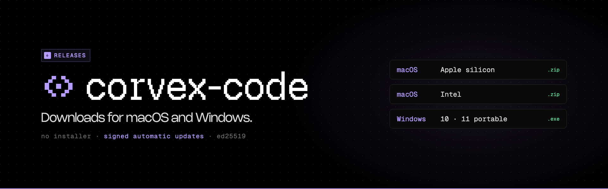

# corvex-code · releases

Downloads of **corvex-code**, the executable code editor by Corvex: run code locally, chain scripts into flows,
Claude Code, Codex and Gemini built in, live bridge to Corvex.

**[Download the latest version](https://github.com/CorvexDevelops/corvex-code-releases/releases/latest)** · [website](https://corvexdevelops.github.io/corvex-code.html) · [Discord community](https://discord.gg/7QXVRfDtFf)

| platform | file |
|---|---|
| macOS · Apple silicon | `corvex-code-mac-arm64.zip` |
| macOS · Intel | `corvex-code-mac-x64.zip` |
| Windows 10 · 11 (x64) | `corvex-code-win-x64-portable.exe` |

No installer. On macOS the app isn't notarized yet: the first time, right-click it and choose Open.

The app updates itself: it reads `latest.json` from the newest release here, checks the Ed25519 signature and the
SHA-256 of the package, and installs the new version when you quit. This repository only holds the releases.

**Help and feedback:** join the [Corvex community on Discord](https://discord.gg/7QXVRfDtFf). Open a ticket for a problem, or post an idea or a bug in
the feedback channel. New versions are announced there first.
